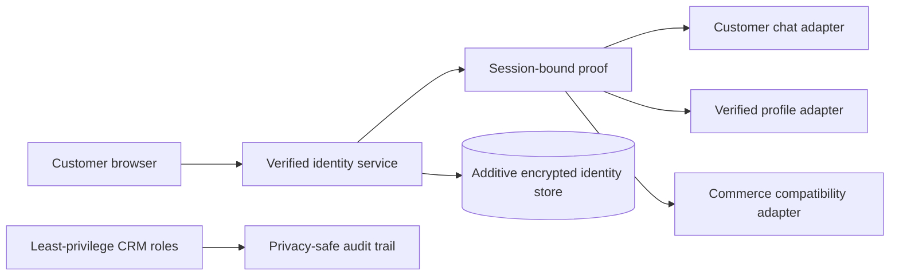

# Customer Identity Security Architecture

Public showcase of a security-first identity foundation designed for a high-traffic WordPress and WooCommerce customer platform.

## Current milestone

Version 0.3.0 adds the reviewed domain model: the state machines that decide whether a one-time code is accepted, and the failure handling that keeps an interrupted worker from locking a customer out of their own sign-in. Runtime activation remains deliberately disabled.

No database schema has been applied, no customer data has been processed, and no staging or Production behavior has changed.

## What this milestone delivers

- A centralized contract for verified customer identity
- Consistent mobile input validation and safe navigation handling
- Explicit fail-closed boundaries for future integrations
- Repeatable packaging, quality checks, and privacy safeguards
- Clear approval gates before migration, pilot, or deployment
- Immutable challenge and rate-limit state machines covered by adversarial tests
- Time-bounded work handoffs that survive a worker failing mid-verification

## Designing for the worker that never comes back

Distributed sign-in flows tend to be specified for success and for rejection, and left undefined for interruption. Two such gaps were closed here.

An exclusive claim on a verification attempt had no deadline. If the process holding it stopped, the claim stayed set, and every later attempt was told that verification was already in progress — the customer locked out of their own sign-in until the code expired, with an attempt already spent. Claims are now leased: past the deadline the holder is presumed gone and the attempt is reclaimable.

The state between a correct code and an issued session had no exit at all. An interruption there left the record held indefinitely, and because that state is not terminal it kept retaining what it was protecting. It now has a recovery path that fails it closed.

Recovery deliberately never returns a spent attempt. Refunding one would make every induced stall a free guess, so an interruption costs the customer one attempt rather than handing an attacker an unbounded budget. A worker that outlives its lease is refused before it can act on a decision it no longer has the authority to apply.

## What we learned about guards

A guard is only worth what the evidence that it still bites is worth. Two findings in this milestone came from testing the tests rather than the code.

A scanning scope that reported a clean tree turned out to be exempting a whole file rather than the known-safe pattern inside it. It looked correct until a deliberately planted credential went unreported.

A pipeline-integrity check compared a file digest before evaluating its structural rules. Every one of its bypass cases therefore stopped at the digest and returned before a rule was reached, so the suite demonstrated only that editing a file changes its hash. Separating the two exposed rules that had never been exercised, several of which did not hold.

Both are now enforced the other way round: the scope and the pipeline rules are checked by tests that fail unless a planted problem is actually reported.

## What the architecture improves

- Centralized verified-mobile identity instead of independent trust rules across customer surfaces
- Transaction-safe OTP lifecycle with replay protection, atomic limits, device binding, and privacy-safe observability
- Session-bound verification provenance so an ordinary login cookie is not mistaken for recent identity proof
- Deterministic, fail-closed handling of duplicate and privileged identities without automatic merges
- Customer-owned chat and profile access derived from the authenticated session rather than browser-supplied identifiers
- Additive, versioned storage that avoids disruptive changes to existing commerce and CRM data
- Sensitive-route cache isolation while preserving cache performance for public catalog pages
- Least-privilege CRM operations, audited overrides, and archive/void semantics in place of destructive actions
- Progressive delivery with backup/restore evidence, isolated staging, shadow validation, limited rollout, and secure rollback

## High-level boundary

## Verified foundation safeguards

- Localized mobile input is normalized consistently and malformed values are rejected safely.
- Navigation targets are constrained to the trusted site boundary.
- The private foundation remains unavailable if its reviewed runtime boundary cannot be verified.
- Repeatable checks cover compatibility, packaging integrity, dependency health, and accidental private-data disclosure.
- The distributable foundation is separated from development and verification tooling.
- Audit records are validated as a whole rather than field by field, so an entry whose parts are each valid but jointly impossible is refused when it is created. During an incident a plausible but wrong reason is worse than a missing one.
- Operational detail in those records is drawn from a closed vocabulary rather than free text, because a free-form field will eventually be handed something that identifies a person.
- Dependency review runs on a schedule as well as on change, since an advisory published after the last change would otherwise go unreported until the next one.

## Approved delivery safeguards

The approved architecture requires encrypted identity storage, abuse controls, request idempotency, concurrency safety, session revocation, privacy-safe observability, secure recovery, and performance protection before runtime activation. Those operational controls remain subject to separate migration, staging, pilot, and Production approvals.

## Delivery status

| Stage | Status |
|---|---|
| Read-only audit | Complete |
| Architecture and security contracts | Complete |
| Private implementation foundation | Complete; deliberately non-operational |
| Reviewed domain model and failure handling | Complete; deliberately non-operational |
| Isolated staging preparation | Approved; no deployment performed |
| Migration and pilot validation | Pending separate approvals |
| Production | Not started |

The private repository contains the reviewed implementation and verification history. Production source, credentials, customer data, infrastructure identifiers, and sensitive security details are intentionally excluded from this showcase.

## Related Portfolio

- Portfolio: https://amiraliyaghouti.com
- Projects: https://amiraliyaghouti.com/projects.html
- Case studies: https://amiraliyaghouti.com/case-studies.html
- GitHub profile: https://github.com/shiny-a2
